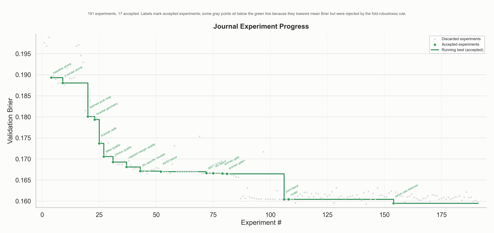
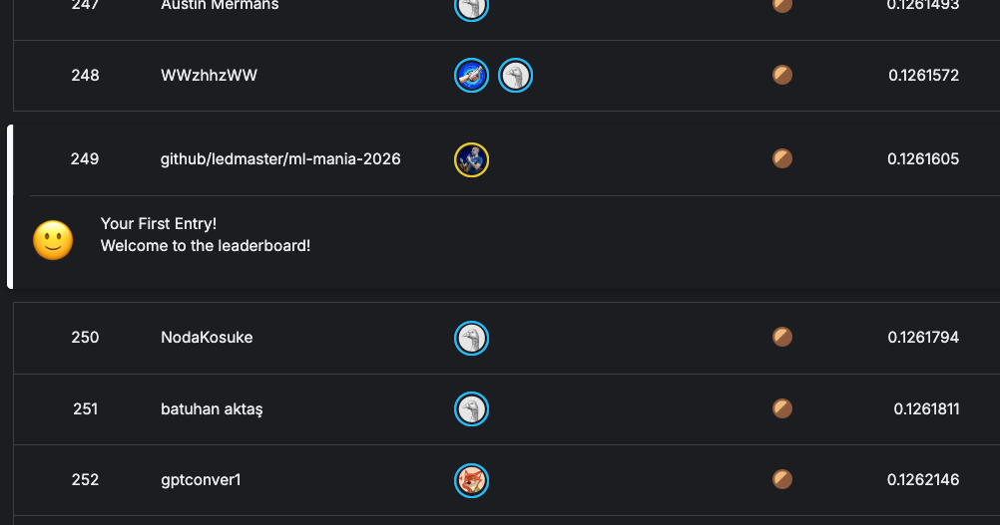

# A Kaggle Grandmaster Tries to Semi-Automate Himself

An experiment in turning years of machine learning experience into a research loop that could run on its own.

## Key Learnings

The final solution is not that important going forward, but the research loop is, so the most useful files from this repo are `checklist-prompt.md`, `AGENTS.md` and `JOURNAL.md`.

These are examples of prompts that I "evolved" manually to get the model to run for a long time. Every time I found a behavior I didn't like, I asked Codex to tell me which instruction got him to do it and fixed it.

Some significant examples:

### `checklist-prompt.md`

This was my autonomous feature engineering prompt. I'm an [old-school Kaggler](https://www.kaggle.com/mariofilho), so my winning solutions were heavily due to engineering features and getting better single models that I could ensemble. This is why I picked this as a good autonomous loop.

Just asking the LLM to iterate on features didn't work. Also, I found that splitting it into two parts: first ask for the model to dump a checklist of feature family ideas to an MD file and then asking another session/agent to run the experiment loop makes it work very well.

`For every pending feature family (unchecked) test adding at least 10 new features`, `It's better to test more features and get no improvement than not testing ideas.`, `Complete one item/family at a time. Work autonomously and only stop when you
have finished the list.` - I wanted to make sure the model tried more than a single feature, but didn't try 200 slightly different variations just to accumulate iterations. Asking the model to "stop only after you do N iterations" made it take shortcuts like creating a big loop of small variations claiming each was an iteration.

`Update the checklist and journal as you complete each item, before moving to the next one.` - This is important, or the LLM will leave the update to the end and might forget what it did. Also, I like the idea of some parts of the checklist getting back to the recent prompts as it works.

`Treat partial progress as non-terminal. Never end the turn just to report status.` - This was a late addition after I asked it why it decided to stop the loop. I like to use LLMs own words in prompts (like "partial progress", "non-terminal") because it might hit embeddings we would not otherwise.

### `AGENTS.md`

In general, it's important to make the rules very clear to the LLM. Tell it about the metric, where it can find available data, what it can and can't do. A simple structure I have used successfully for prompts is:

- Task
- Constraints
- Goal

`As we get deeper into research, it's expected that we will have many iterations without progress in our metric. This is completely normal. Don't get discouraged by it and just look for new angles and unexplored approaches.` - If you don't give it a checklist (like I did above), Codex tends to claim it's not possible to improve a metric after a few unsuccessful trials. This seems to have reduced this issue, though the checklist solution is better.

`Evaluation And Validation` - This is crucial, as I talk about later in this article. Be redundant in the instructions if necessary to make the model paranoid about lookahead bias and future leakage.

`Default experiment runs should be validation-only.`, `Only create a full Stage 2 submission file and persist trained model artifacts when the user explicitly asks for them.`, `For routine rejected experiments, a validation summary is enough. Do not require model dumps or submission artifacts to consider the run complete.` - At first Codex ran a full pipeline saving the model and submission files for each experiment. We don't need this, as most experiments will fail and we can pick the one we want at the end to reproduce and submit.

`Use JOURNAL.md at the repository root to log experiments.`, `Log every completed run that changes...` - This is what allows the model to work cross-sessions/days/compactions. Very important.

## Why Did I Do This?

I was inspired by [Dimitris Papailiopoulos](https://github.com/anadim/AdderBoard/)'s experiments with autonomous research loops for finding the smallest Transformer that could learn to add two 10-digit numbers.

That made me want to try a semi-autonomous, "vibe-coded" approach on a real machine learning competition.

[March Machine Learning Mania](https://www.kaggle.com/competitions/march-machine-learning-mania-2026/) felt like a good fit because the dataset is small enough to iterate on locally on my old Intel Mac.

The main caveat is that the final leaderboard is noisy and heavily influenced by tournament upsets. A bad final result does not necessarily mean the underlying process was poor, and a good result can still include a fair amount of luck.

This repository contains all the artifacts and scripts generated by this research pipeline.

## What was the competition about?

March Machine Learning Mania is Kaggle's annual March Madness prediction competition.

For Stage 2, the task was to predict NCAA tournament game outcomes for both the men's and women's brackets using historical college basketball data: regular-season results, tournament results, seeds, box-score stats, rankings, and other related metadata.

Kaggle asked for a probability for every possible same-division 2026 matchup in [`data/SampleSubmissionStage2.csv`](data/SampleSubmissionStage2.csv). Each row used `ID=Season_LowerTeamID_HigherTeamID`, and the target was `Pred = P(lower TeamID wins)`. 

In practice, only the rows corresponding to games that were actually played mattered for scoring, but the model had to be able to generate probabilities for the full matchup universe.

The evaluation metric was Brier score, which in this setting is just mean squared error on predicted win probabilities.

## A Crucial Human Part: Validation Splits

Validation for time-series problems can get tricky very quickly. Often it is enough to make sure the training data comes strictly before the validation data, but that was not enough here.

March Madness has a lot of season-to-season drift. Team quality changes, play styles change, selection dynamics change, and the usefulness of a given feature family can shift meaningfully from one year to the next.

Because of that, I did not want to trust a single average validation score without looking at how the change behaved across individual seasons.

For example, a model change might help a lot in 2023, hurt 2021, 2022, 2024, and 2025 a little, and still come out ahead on the average Brier score.

That is not the kind of improvement I wanted to accept. It is too easy to mistake a year-specific quirk for a real gain.

So from the start I used a simple rule: a change only counted as an improvement if it lowered the mean validation Brier and improved at least 4 of the 5 validation seasons.

That was strict enough to block a lot of fragile ideas, but not so strict that a single weird tournament year killed every promising direction.

Agentic systems are very good at exploiting weaknesses in the objective you give them.

If the validation setup is weak, they will eventually find ways to look better without actually becoming more robust.

Getting the validation rules right was probably the most important human part of the whole process, as it was based on my hard-earned experience.

## Local Validation Protocol

- Validation folds are the latest 5 completed seasons: `2021-2025`.
- Each fold trains only on prior seasons.
- Historical feature construction respects a Selection Sunday style information cutoff.
- Official evaluation excludes actual First Four rows to match the competition scoring surface.
- A candidate is accepted only if it lowers mean Brier and improves at least 4 of the 5 folds.
- Final submission generation first reproduces the saved refreshed-data benchmark within the stored tolerance and aborts if the numbers do not match.

## How Did I "Validate" The Final Submission

A rule I had is to not look at the code, only interact with Codex and documentation-style files. For the final submission, I wanted to make sure that Codex reproduced the best solution found during research correctly.

As I obviously didn't have labels for the 2026 matchups, I asked Codex to do an "unsupervised" sanity check on the final submission.

The check I asked for was simple: build a very basic reference model based only on seed differences.

For each historical validation season, Codex fit separate men’s and women’s logistic seed baselines using only `delta_seed_number`, always training on seasons strictly before the scored season.

Then it compared the final model’s predicted probabilities against that seed-only baseline using Pearson correlation, restricted to seeded-versus-seeded matchups.

I was not using the seed baseline as a real model. I only wanted a cheap structural check.

If the final 2026 submission was wired correctly, its seeded-game predictions should look broadly similar to the historical relationship between the accepted model and a simple seed-based benchmark.

On the official validation folds, that correlation was very stable: `2021=0.9432`, `2022=0.9575`, `2023=0.9498`, `2024=0.9526`, `2025=0.9469`, with a mean of `0.9500`.

For the 2026 submission, the same comparison gave `0.9575` overall on the official-like seeded subset, with men at `0.9519` and women at `0.9653`.

That was reassuring to me because the 2026 submission sat comfortably inside the historical validation range.

It did not prove the submission was good, but it was a strong sign that Codex had reproduced the accepted model behavior instead of drifting into some bug.

## Another Human Intervention: Never Start From Scratch

More than a decade of Kaggle and machine learning experience taught me to never start a solution from scratch. Always look for solutions that tried to solve the same problem or similar problems.

In this case it meant looking at [previous seasons winning solutions](https://www.kaggle.com/code/sudalairajkumar/winning-solutions-of-kaggle-competitions), downloading their notebooks and instructing Codex to design experiments to use their methods in our pipeline.

Most literal notebook translations did not survive contact with the repo's validation rule.

Early attempts to port prior-season `team_quality`, selected-stat subsets, isotonic calibration, extra Massey summaries, Mike Kim's late-season form and matchup priors, and Vilnius's spline calibration, Elo, and stat-pruning ideas all failed the repo's acceptance rule and were rejected.

But the notebooks still helped a lot because they pointed us toward the right abstractions.

The GOTO and third-place notebooks pushed Codex toward bracket geometry and bracket-aware calibration, which became the accepted iterations 24 and 26.

Mike Kim's seeded-team filtered-quality idea was an even bigger win and improved all 5 validation folds in iteration 28.

Then the Vilnius notebook's unregularized filtered-quality fit beat Mike's version in iteration 32, and the capped-margin follow-up became the additive second quality view in iteration 38, which improved all 5 folds again.

So the notebooks were useful less as blueprints to copy and more as a map of promising ideas that could be translated, stress-tested, and kept only when they actually held up in our validation scheme.

## Final Solution

The final solution is a routed blend of multiple accepted LightGBM margin-model families built on bracket-aware Selection Sunday features.

### Features

The final feature stack starts from a pooled, submission-aligned matchup table where every row is oriented as `LowerTeamID` versus `HigherTeamID`.

The core feature groups are:

- current-season team box-score averages and matchup deltas, including score, field-goal attempts, rebounding, blocks, fouls, opponent box-score stats, and average point differential
- tournament seed context, including raw seed values, numeric seed differences, and a shared default seed fallback for unseeded rows
- bracket geometry derived from tournament slots, such as `possible_round`, same-region flags, Final Four side, play-in indicators, opening-slot indices, opening-slot gap, first-weekend pod, and regional quadrant structure
- bracket interaction features such as `possible_round x delta_seed_number`, `same_region_flag x delta_seed_number`, `same_final_four_side_flag x delta_seed_number`, and related slot/round interactions
- same-season tournament-focused quality views carried forward from earlier notebook-inspired branches:
  - `vilnius_quality`
  - `capped_margin_quality`
  - `seed_closure_quality` on the alternative branch
- the final accepted `Current-season block-rate features` family, which adds split views for overall block rate, late-season block rate, neutral-site block rate, and home-road block-rate gap, each represented as `low`, `high`, and `delta` columns

In practical terms, the final archived submission reuses the official feature-family driver's two source tables: the iteration 38-style bracket-aware pooled stack and the iteration 49-style alternative stack with `seed_closure_quality`, then layers the accepted block-rate family onto both.

### Models

The important model families are:

- `iteration_38` feature-stack regressor:
  - pooled bracket-aware Selection Sunday model with Vilnius filtered quality plus capped-margin quality
- `iteration_41` tuned regressor:
  - an Optuna-tuned pooled LightGBM regressor trained on the same iteration 38 feature table
- `iteration_44` division-specific composition:
  - men use the accepted iteration 38 regressor
  - women use the tuned iteration 41 regressor
- `iteration_49` alternative branch:
  - extends the iteration 38 feature stack with two-hop `seed_closure_quality`
  - keeps the iteration 44 division-specific model and calibration setup on that alternative table
- `iteration_53` benchmark branch:
  - blends iteration 44 and the capped seed-closure alternative at raw-margin level with weights `0.75 / 0.25`

Those earlier model families are then reused as the source models for the late-stage probability blend that powers the final official benchmark and submission script.

### Calibration

All source models predict margin first, not probability directly. The repo then maps margins to probabilities with nested out-of-fold logistic calibration.

There are two calibrated probability views in the late-stage stack:

- `iteration_69`:
  - raw margin = `0.955 * benchmark + 0.020 * iteration_38 + 0.015 * iteration_49 + 0.010 * iteration_41`
  - calibrated with the benchmark branch's bracket-aware calibration lineage
- `iteration_71`:
  - raw margin = `0.965 * benchmark + 0.020 * iteration_38 + 0.015 * iteration_49`
  - calibrated with the division-aware calibration lineage used in the later official branch

Both calibrators are fit using only prior seasons relative to the scored season. In other words, the final probability mapping keeps the same walk-forward discipline as the model-selection loop instead of fitting a single global calibrator on all historical rows.

### Ensemble

The final ensemble happens in two layers.

First, the system builds the two calibrated probability views above: `iteration_69` and `iteration_71`.

Second, it routes between them using men- and women-specific probability-gap tables based on `abs(iteration_71 - iteration_69)`.

The fixed official router used by the final archived submission is:

- men:
  - low gap `<= 0.040`: use `44%` iteration 71 and `56%` iteration 69
  - mid gap `<= 0.0425`: use `34%` iteration 71 and `66%` iteration 69
  - high gap `> 0.0425`: use `38%` iteration 71 and `62%` iteration 69
- women:
  - low gap `<= 0.054`: use iteration 71 only
  - mid gap `<= 0.065`: use iteration 69 only
  - high gap `<= 0.080`: use iteration 69 only
  - extreme gap `> 0.080`: use `24%` iteration 71 and `76%` iteration 69

That routed blend was the accepted official benchmark before the final feature sweep. The final improvement was to keep that routing logic fixed and add the `Current-season block-rate features` family on top, which is why the archived post-refresh submission is best described as a block-rate-enhanced version of the accepted official routed blend rather than a brand-new model family.

## Polymarket Overlay

Historically competitors used outside information like 538 predicted probabilities. Some past winning solutions are based on simply adjusting these odds in a smart way.

As prediction markets tend to be great information aggregators, I asked Codex to try several submission-time Polymarket overlays.

The first overlay used direct head-to-head Polymarket moneylines when they could be mapped cleanly to Kaggle rows. Codex blended those market probabilities with the final base submission in logit space, used liquidity-quintile weights from `0.1` to `0.5`, and capped each row's move at `0.05`. That direct-game overlay only touched `28` submission rows.

The second overlay, which is preserved in code, used Polymarket's 2026 men's title-futures board instead of individual game markets. I asked Codex to fetch the `2026-ncaa-tournament-winner` board, normalize it to fair title probabilities, compare those prices to the model-implied title odds from exact bracket dynamic programming over the men's seeded field, convert the resulting team-level logit gaps into small team offsets, and then push those offsets back into seeded men field matchups only. That version used `alpha=0.10`, a team-offset cap of `±0.10`, and a per-game move cap of `±0.03`, and it adjusted `2278` seeded men rows.

A few hour before the end, I made a more aggressive direct-market decision.

Instead of blending direct moneylines, I told Codex to replace the model probability outright with the current Polymarket bid/ask midpoint whenever a live March Madness head-to-head market could be uniquely mapped and had `volume > 10000`. That aggressive direct overlay touched `31` rows.

One or two games with a slightly better prediction can be the difference between 100s of places in the final leaderboard, and I don't believe our model is better than the market-aggregated info, so it stands to see how much of a difference this will make.

After that, I kept those `31` direct replacements fixed and applied the conservative men's title-futures overlay only to the remaining eligible seeded-field rows.

## Results

| Snapshot | Meaning | Mean Brier | Artifact |
| --- | --- | ---: | --- |
| Refreshed current snapshot | Reproduced benchmark used for the archived base submission | 0.159773 | [`artifacts/final_stage2_current_snapshot_block_rate/validation_summary.json`](artifacts/final_stage2_current_snapshot_block_rate/validation_summary.json) |
| Final Kaggle result | Final leaderboard finish: `249th`, ahead of `92%` of participants | 0.1261605 | [`docs/final-pos.png`](docs/final-pos.png) |

Refreshed-snapshot fold scores: `2021=0.178380`, `2022=0.185079`, `2023=0.171144`, `2024=0.142189`, `2025=0.122073`.

A few days before the end, the local Kaggle data was refreshed and some rows were corrected. That changed the validation scores slightly, so the numbers shown here are the post-refresh ones used for the final archived submission.

## End of Experiment

The experiment is over. The final submission finished `249th`, which beat `92%` of participants.

With the caveat that this was a higher-than-usual randomness competition, Codex with GPT 5.4 seems good and reliable enough to assist in building day-to-day ML solutions.

## Repository Guide

- [JOURNAL.md](JOURNAL.md): full experiment log, including every accepted and rejected run.
- [scripts/generate_final_stage2_current_snapshot_block_rate_submission.py](scripts/generate_final_stage2_current_snapshot_block_rate_submission.py): canonical public entrypoint for rebuilding the archived base submission.

## Post-Mortem Comparison to 1st Place (by GPT 5.4 XHigh)

After reading the [1st place writeup](https://www.kaggle.com/competitions/march-machine-learning-mania-2026/writeups/march-machine-learning-mania-2026-1st-place-solut), my main conclusion is that the offline-model gap was much smaller than the final leaderboard gap suggests.

The winner reported a calibrated cross-validation Brier of `0.1590`. Our accepted benchmark was `0.159473` on the pre-refresh snapshot and `0.159773` on the refreshed snapshot. That is a real gap, but not a dramatic one. The bigger difference seems to be a handful of tournament-specific decisions rather than a fundamentally different class of model.

- He attacked the exact area where our diagnostics said we were weakest: near-even men's games and small seed-gap matchups. Our own error analysis flagged mid-confidence rows, `abs_seed_gap=1`, and the larger men low-gap routing regime as recurring weak points.
- He injected stronger current-state men's information into the model through manual injury deductions and hand-tuned reranking. We did not carry injuries into the core model, and our late Polymarket overlays helping the men's side is good evidence that missing current-state information mattered.
- He treated men and women as separate modeling problems from the start. Our final system still used a pooled backbone with division-aware calibration and routing layered on top.
- He was more willing to optimize for leaderboard upside instead of only robust walk-forward behavior. Global isotonic calibration and snapping very extreme probabilities to `0` or `1` are both more aggressive than the way this repo selected and shipped the base model.
- He stayed much more minimalist on the final feature set. Our final submission came from a routed multi-branch LightGBM stack with multiple quality views, bracket geometry, and late-stage probability routing, while his final solution concentrated on seed differential, a custom rating differential, quality wins, and one women's stat feature.

My read is that his edge came mostly from better men's current-state priors, better reranking inside similar seed bands, and more aggressive post-processing, not from a massively superior validation score. If I were rerunning this competition, the first follow-up would be a simple men-only current-state adjustment layer plus a cleaner same-seed or adjacent-seed reranker before adding any more ensemble complexity.

## Post-Mortem Comparison to 2nd Place (by GPT 5.4 XHigh)

After reading the [2nd place writeup](https://www.kaggle.com/competitions/march-machine-learning-mania-2026/writeups/2nd-place-solution-for-the-march-machine-learning), my main conclusion is almost the opposite of the 1st place comparison: this looks less like a stronger average-year model and more like a simpler, chalk-friendly tournament model that happened to match 2026 very well.

Compared to this repo, the 2nd place solution is dramatically simpler. It uses a pooled men's + women's training set, a `60 / 40` XGBoost plus Logistic Regression blend, a compact seed/Elo/Massey/efficiency feature set, and explicit clipping to `[0.02, 0.98]`. Our final archived submission came from a routed LightGBM stack with bracket geometry, multiple quality views, nested calibration, and men/women-specific probability routing.

The biggest difference is validation philosophy. This repo used strict season-based walk-forward validation and only accepted a candidate if it lowered mean Brier and improved at least `4` of the last `5` seasons. The 2nd place writeup used random `10`-fold cross-validation over the combined tournament training set. That makes the reported leaderboard finish much harder to interpret as evidence of a stronger underlying model. In fact, their own writeup reports Logistic Regression outperforming XGBoost standalone in both genders, which suggests the final blend was chosen more for tournament fit than for a cleaner average-year validation story.

- Relative to us, the 2nd place solution appears to have benefited from simplicity, strong seed-and-ranking priors, and explicit tail control in a very chalky year.
- Relative to 1st place, it looks much less sophisticated: no injury adjustments, no hand-tuned reranking layer, no men's/women's separation at training time, and no clearly superior offline validation score.
- Relative to both winners, it reinforces that 2026 rewarded conservative, seed-aligned probabilities more than a typical year.

My read is that the 2nd place solution is not the main blueprint to copy. The more useful lesson is to keep a very strong simple seed/Elo/Massey baseline around as an anti-overengineering benchmark, while still prioritizing the kinds of men-specific current-state adjustments and reranking ideas that the 1st place writeup handled more directly.

## Post-Mortem Comparison to 3rd Place (by GPT 5.4 XHigh)

After reading the [3rd place writeup](https://www.kaggle.com/competitions/march-machine-learning-mania-2026/writeups/3rd-place-solution-march-machine-learning-mania), my main conclusion is that it is the hardest one to compare directly to this repo because it is not just a model writeup. It is a full submission-time system built around separate men's and women's Logistic Regression models, aggressive feature pruning, and a heavy external-information layer: Barttorvik, KenPom-style preseason data, AP Poll, coach history, women's NET, ESPN BPI, Vegas moneylines, and Kalshi futures.

Relative to this repo, the core modeling choice is much simpler. The base model is just Logistic Regression on differential features with gender-specific pruning and regularization, not a routed multi-branch LightGBM stack. But the overall submission is much more operationally aggressive because the final predictions are heavily blended with live market probabilities, especially in Round 1 where the men's submission trusts the market consensus at `90%` and the women's at `75%`.

The most important difference is that the 3rd place approach explicitly turns the final submission into a market-assisted prediction product rather than a self-contained pre-tournament statistical model. That likely mattered a lot in a year where current-state information, matchup-specific context, and live pricing were highly valuable. It also means the comparison is less apples-to-apples than either the 1st or 2nd place solutions.

- Relative to us, the 3rd place solution likely gained most from external information and market blending, not from a more complex core learner.
- Relative to 1st place, it is less hand-crafted around committee seeding and custom reranking, but much stronger on external current-state inputs.
- Relative to 2nd place, it is far more ambitious operationally: separate men's and women's models, much heavier feature pruning, and a much more serious market overlay.
- The reported leave-one-season-out CV of `0.12352` is far better than the internal-data solutions, but it should be interpreted with caution because it depends on a wider external data stack and on point-in-time assumptions that are harder to verify than the fully self-contained Kaggle-data pipelines.

My read is that the 3rd place solution is the strongest example of a submission-time edge built from outside information. If I were borrowing one lesson from it, it would not be to replace LightGBM with Logistic Regression by default. It would be to separate the problem into two layers: a robust internal benchmark and a deliberately external, market-aware overlay layer that is evaluated and governed separately.

## Final Comparison Across Top Solutions (by GPT 5.4 XHigh)

Looking across the top three writeups, each one beat this repo in a different way.

- `1st place` looks like the strongest apples-to-apples competitor. It stayed mostly inside the competition ecosystem, separated men and women, added men-specific current-state judgment, and reranked teams inside the seed structure more directly than we did.
- `2nd place` looks like the strongest simplicity baseline. It says that in a chalk-heavy year, a compact seed/Elo/Massey/efficiency model with conservative tail handling can outperform a much more elaborate pipeline.
- `3rd place` looks like the strongest external-information system. It treated the model as only one component of the final submission and leaned heavily on live market and external ranking information.
- `This repo` looks strongest in research-loop discipline and validation rigor. The walk-forward protocol, the `4-of-5` acceptance rule, and the experiment log made the process much more trustworthy than a typical competition workflow, even if the final submission underused current-state information.

My overall conclusion is that the biggest missing piece was not more model complexity. It was a cleaner separation between:

- a robust internal benchmark selected under strict walk-forward validation
- a men-specific current-state reranking layer
- a submission-time external-information overlay that could be audited separately from the base model

If I were rerunning the competition, that is the architecture I would aim for: keep the disciplined benchmark, keep a simple anti-overfitting baseline in the loop, add a focused men-side reranker, and treat market-based adjustments as a distinct final-mile system rather than mixing everything into one research objective.
